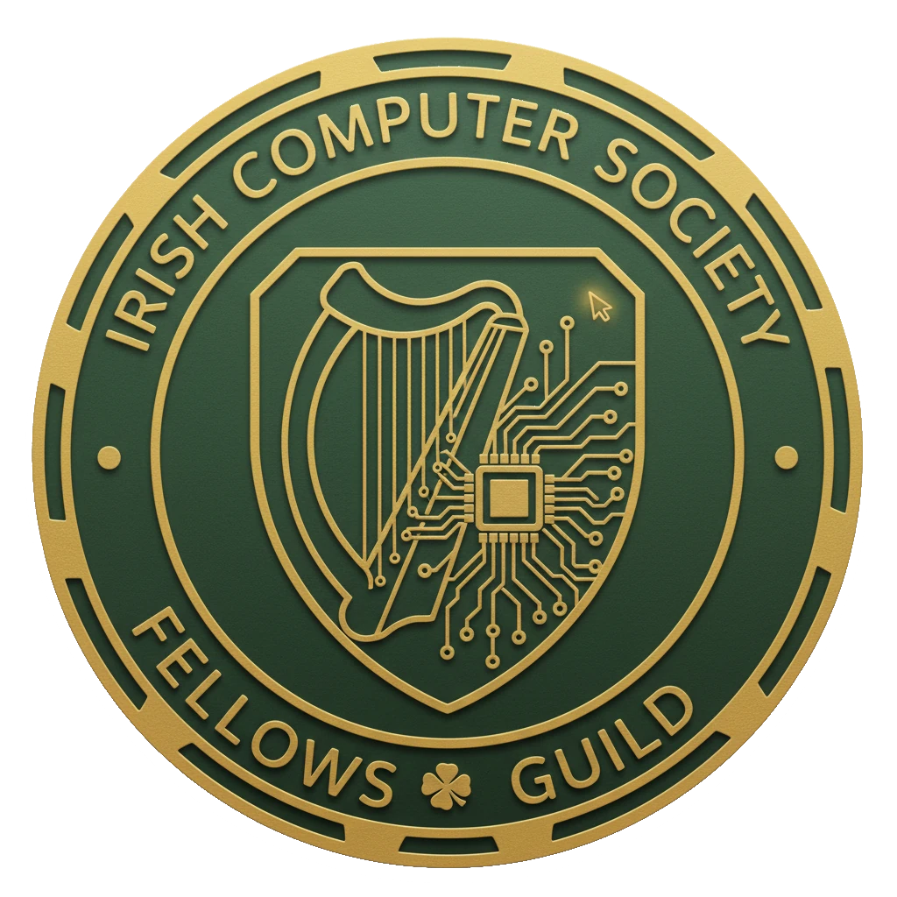

# {{ title }} 

In November 2026, I was admitted as a Fellow of the [Irish Computer Society (ICS)](https://ics.ie/) and invited to join the [ICS Fellows Guild](https://ics.ie/fellows/).

I have been a member of the Irish Computer Society for many years and have benefited greatly from its community and events.

Earlier in my career, I was actively involved in [IASA](https://ics.ie/iasa/), the International Association of Software Architects, whose Irish chapter is run through the ICS. This group helped me progress my career into software architecture.

More recently, I have been involved in the [Strategic AI Network (SAIN)](https://ics.ie/sain), which is focused on the responsible and ethical use of AI.

I look forward to working with the Fellows Guild in the years to come.

