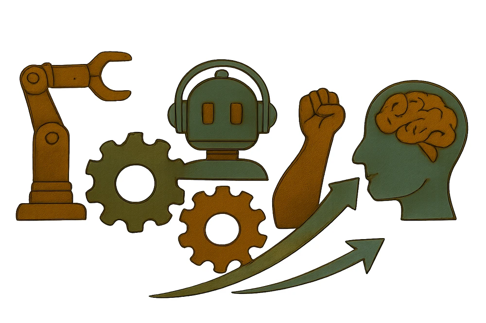
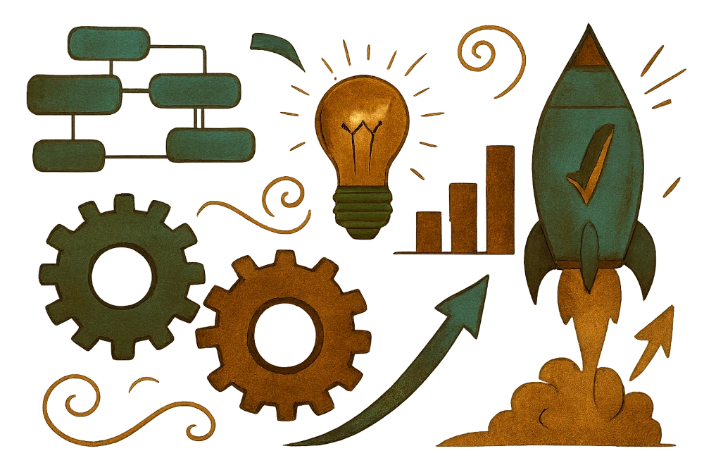

# {{ title }} 

Nobody can predict the future, but we can look back at previous waves of technological change and anticipate how some aspects of the current wave of AI transformation will evolve over time, even if the timeline is unclear.

AI is changing how we work. We don't know what shape these future changes will take, but they're coming, and they will be disruptive enough that everyone needs to be ready to adapt.

This guide focuses on software engineering, though much of it applies more broadly, to all knowledge work. Whether you're entering the job market, worried about what AI means for your career, or managing a team through this period of change, understanding what's ahead will help you make better decisions now.

## The Onboarding Paradox

As AI can now be used to automate basic and repetitive tasks, companies are rethinking their workforce strategies, and many have frozen hiring altogether. The focus is shifting towards experienced staff who can manage AI agents and use their expertise to optimise workflows and to get more out of these new tools.

But this creates a paradox. If companies stop hiring, who will have the knowledge to manage AI agents once today's experienced staff move on or retire? And how are people entering the job market meant to build the knowledge and experience needed to judge whether an AI agent is doing good work?

The traditional career path, starting in narrow roles and gradually expanding expertise over years, is no longer practical.

This paradox calls for a different approach to education and career development, one built around [broad system thinking, ethical reasoning, communication skills and adaptability from day one](/ai/workplace-readiness-needs-to-shift-left/).

## Four Stages of AI Advancement in Work

Understanding where we are, and where things are heading, will help you plan what to learn next. Here are four stages, starting with where most of us are today.

### Stage 1: AI as Task Automation Assistant

*UPDATE: As of mid 2026, AI capabilities have evolved past this stage*

**What AI Can Do**

AI assistants handle well-defined tasks within larger workflows. In software engineering, this means: boilerplate project setup, code completion, bug detection, and writing documentation. They need detailed prompts and constant oversight.

**General Work Impact**

AI assists skilled workers with specific tasks: lawyers review AI-generated summaries, marketers use AI first drafts, analysts use it to clean datasets. Humans still make every key decision and review every output. Companies are starting to ask whether they need as many entry-level roles.

**Software Engineering Reality**

A skilled engineer writes detailed prompts and instruction files that direct AI assistants to generate code using specific languages and conventions. Humans stay in control by reviewing the output continuously and steering the AI as needed. AI is a productivity multiplier, but only for those who already know what good code looks like.

**The Critical Gap**

Junior engineers entering the job market now face the challenge of learning to review AI outputs without having the experience and intuitive pattern recognition that comes from writing thousands of lines of production code themselves.

### Stage 2: Agentic AI for Full Feature Delivery

**What AI Can Do**

AI agents evolved beyond the generation of single functions to handle complex, multi-component tasks. They can deliver entire features, including database migrations, API endpoints and frontend components, working across the technology stack with moderate supervision.

**General Work Impact**

The focus shifts from deep specialised knowledge within narrow domains to the ability to orchestrate AI agents across end-to-end business processes. Employees who understand how systems and processes work together are becoming more sought after than those with deep but narrow expertise.

**Software Engineering Reality**

A skilled full-stack engineer can now direct an AI agent to build a complete feature in a fraction of the time it used to take a full team of specialist engineers.

Specialist engineers who use AI can find themselves blocked as they wait on other parts of the system to be implemented by other engineers. A full-stack engineer who can break down complex problems into AI-directable tasks, and review the AI-generated code across the whole stack, has a [clear advantage](https://declanbright.com/software/fullstack-software-engineers-in-the-ai-era/).

**The Critical Challenge**

Code review becomes the primary bottleneck in the Software Development Lifecycle. If code reviews require multiple specialists, the productivity gains from using AI agents start to disappear. Organisations need software engineers who can effectively review code across the full stack, checking for security, performance, and quality across all components.

### Stage 3: AI as Universal Implementer (Emerging)

**What AI Can Do**

AI agents can navigate and modify large, complex codebases with minimal guidance. They understand business context, make sound architectural decisions within established patterns, and can refactor entire subsystems. Rather than simply implementing what they're told, they suggest approaches and weigh up trade-offs.

**General Work Impact**

Employees need to prioritise fundamental knowledge that ages slowly and applies across contexts: core principles, patterns and mental models, rather than specific tools or syntax. The ability to learn quickly and reason from first principles becomes the skill that sets people apart. Specialist expertise remains valuable, but mostly when combined with broader design thinking.

**Software Engineering Reality**

AI agents handle the bulk of implementation and integration work across the stack. The human contribution centres on agent management, architectural design, system decomposition, and quality verification. Engineers must ask: Does this solution follow sound architectural patterns? Is it secure? Does it scale? Is it maintainable?

The most valuable software engineers are those who understand the broader system architecture and can critically assess the quality of AI-generated solutions against fundamental principles and requirements.

**The Identity Shift**

This stage requires software engineers to reimagine their professional identity. If you built your career on deep and specialist expertise (in JavaScript / micro-services / database development / distributed systems optimisation), you must now broaden your understanding of architectural fundamentals across all of these domains rather than staying an expert in just one.

This isn't just a skills challenge, it's a self-reflective transition that requires humility and a willingness to be a beginner again in adjacent domains.

### Stage 4: AGI & Autonomous Knowledge Work (Future State)

This stage is highly speculative, both in timeline and form. I include it for completeness, acknowledging the limited ability to predict this far ahead.

**What AGI Might Be Capable Of**

Artificial General Intelligence (AGI) represents AI systems that can autonomously handle the vast majority of complex knowledge work across all domains. Unlike earlier stages where humans direct AI agents, it's likely that AGI systems will independently understand the context of problems, devise solutions, implement them, and iteratively adapt and learn based on outcomes, all with minimal human guidance (presuming that [alignment](https://www.anthropic.com/research/alignment-faking) and [containment](https://www.anthropic.com/engineering/how-we-contain-claude) are solved problems).

**Possible Human Roles**

If and when this stage arrives, human work will shift dramatically:

* **Creative direction**: Defining what should exist, not just how to build it. The "why" questions that require human context, culture, and vision 
* **Governance and oversight**: Setting boundaries, defining what systems should and shouldn't do, especially in regulated industries such as healthcare, finance, and law where human accountability remains essential  
* **Value alignment**: Ensuring AI systems pursue goals that align with human values and societal good  
* **Edge cases and exceptions**: Handling situations that fall outside normal parameters, where human judgement and empathy are irreplaceable  
* **Interpersonal work**: Roles that inherently require human connection, trust, and emotional intelligence

**Why This Is So Uncertain**

Predicting this stage is difficult:

* We don't know if current AI architectures can scale to true AGI, or if fundamental breakthroughs are required in areas such as real-time learning
* The timeline could be 5 years, 10 years or 50+ years, or AGI might not arrive at all  
* The transition could be gradual (extending Stage 3 indefinitely) or sudden and disruptive  
* Regulatory, ethical, and societal factors may shape or limit AGI deployment regardless of technical capability

**What This Means for Your Career**

Rather than planning specifically for Stage 4, focus on building adaptability as a skill. The software engineers who thrive during Stages 1 to 3, by embracing continuous learning, developing architectural thinking, and staying grounded in fundamental principles, will be best positioned to navigate whatever Stage 4 brings, if it arrives at all.

It's impossible to fully future-proof your career against AGI. The goal is to build the learning capacity and adaptability that keep you valuable through multiple waves of change.

Setting AGI aside, here's what matters for the roles hiring today:

## Reclaiming the "Software Engineer" Job Title

Across all these stages of AI advancement, one thing holds true: engineers who can work across the [full stack](/software/fullstack-software-engineers-in-the-ai-era/) and think architecturally become more valuable, not less.

Martin Fowler's writing on [Expert Generalists](https://martinfowler.com/articles/expert-generalist.html) describes this profile well: someone with deep understanding of fundamental principles that apply across domains, broad exposure to multiple areas of the stack, and the ability to see how components fit together into coherent systems.

However, the term "[Expert Generalist](https://martinfowler.com/articles/expert-generalist.html)" has a limitation as a job title. It doesn't scale down the experience ladder. "Junior Expert Generalist" is contradictory. In practice, "Expert Generalist" describes a mindset rather than a job title.

I suggest we reclaim the "Software Engineer" job title as it was originally used, before it was prefixed with so many narrow specialisations. A modern Software Engineer builds software systems across the full stack: frontend, backend, and everything in between, just like the good old days! Returning to a career ladder that looks something like: Junior Software Engineer → Software Engineer → Senior Software Engineer → Principal Software Engineer.

**The Strategic Advantage**

Software Engineers can:

- Direct AI agents more effectively because they understand what good looks like across the full solution space
- Break down complex problems into AI-directable tasks that span the entire stack
- Review AI-generated code for systemic issues, not just surface-level correctness, for example spotting when a front-end solution will create a back-end performance problem, or when a database design decision will impact UI responsiveness

As AI capability grows, we need more software engineers who think this way, at every level of seniority. What separates a Junior Software Engineer from a Principal isn't the scope of what they work on, but the depth and breadth of their architectural judgement and their ability to use AI to solve complex problems.

## A Career Development Path for the AI Era

The traditional career path of starting narrow and gradually expanding won't prepare graduates quickly enough. Here's how to position yourself based on where you are in your career:

### If You're Entering the Field (Students & Career Changers)

Your goal: become AI fluent while building fundamental knowledge, and avoid becoming dependent on AI for things you should understand yourself.

**Immediate Actions (Months 1-6)**

**1\. Build AI fluency as a learning tool, not a crutch**

* Use AI to explain and learn new concepts, not just generate solutions
* Use AI to review its generated code and explain its reasoning: "Explain why you chose this approach" or "What are the trade-offs of this solution?"  
* Develop the habit of asking "Why?" before accepting any AI suggestion
* Use AI to refactor code that looks overly complicated

**2\. Focus on fundamentals over frameworks**

* Instead of only mastering the most popular UI framework, understand the concepts of UI rendering and state reconciliation patterns  
* Instead of relying solely on ORMs, learn about SQL, data modelling, indexing strategies, and query optimisation principles  
* Study distributed systems concepts: messaging, partitioning, replication, consistency, fault tolerance  
* Learn security fundamentals that apply across languages and frameworks: authentication, authorisation, input validation, encryption, secure session management, and the OWASP Top 10

**3\. Practice full-stack thinking from day one**

* Build small but complete projects that span every layer: database, API, frontend, and deployment pipeline
* Don't just make it work, understand the trade-offs you're making at each layer  

**Medium-term Development (Months 6-24)**

**4\. Develop code review skills across the stack**

* Review others' code in domains outside your comfort zone  
* Learn to spot architectural problems by asking AI to explain code in unfamiliar areas: "What security vulnerabilities might exist in this code?", "How could this be exploited by a malicious user?", "What performance issues could arise at scale?" 
* Develop an adversarial mindset: always ask "What could go wrong?" and "How might this be abused?"

**5\. Cultivate the right mindset**

* **Curiosity**: default to "I want to understand why this works," not "I just need it to work"  
* **Humility**: when learning new domains, try to understand why existing approaches exist before assuming you know better  
* **Customer focus**: always ask "How does this technology choice help the user?"  
* **Sympathy for adjacent domains**: if you're working on backend, think about the needs of the frontend; if you're working on the UI, consider data processing and storage constraints

**6\. Find mentors with experience across the full stack**

* Seek out experienced colleagues who've successfully worked across multiple domains  
* Be curious and don't hesitate to ask for guidance, this is a strength, not a weakness
* Ask them: "How do you approach learning new domains quickly?"

### If You're Established in Your Career (Mid-Level and Senior Engineers)

The challenge is to expand from specialist depth to generalist breadth, while building the broader skills of full system architecture design.

**Assess Your Current Position**

Ask yourself honestly: do you work mainly in one part of the stack? Do you feel uncomfortable reviewing code outside your domain? Can you judge the quality of AI-generated code in unfamiliar territory? If the answers point to narrow specialist expertise, now is the time to broaden your skillset.

**Expansion Strategy**

**1\. Map the full stack and identify your gaps**

* Where are you strong? Where are you weak?
* What domains do you actively avoid or defer to others?
* Prioritise learning adjacent domains first (backend engineers learn frontend, frontend engineers learn backend APIs and data modelling)

**2\. Learn through doing, with AI as a guide**

* Create personal learning projects that span the full stack, related to a hobby or interest (music apps, cooking planners, sports trackers) 
* Take on work tasks outside your primary domain  
* Use AI to accelerate learning: "Explain the standard patterns for X" or "What are the common mistakes in Y?"  
* Have experienced engineers review your work in new domains and learn from their feedback

**3\. Study architectural patterns, not just implementation details**

* Read about system design patterns: microservices, event-driven architecture, CQRS, serverless patterns  
* Understand trade-offs: when is a monolith better than microservices? When should you denormalise data?  
* Learn to think about quality attributes: how does an architectural decision affect security, data privacy, scalability, maintainability, and cost?

**4\. Practice system decomposition**

* When building complex features, practice breaking them into AI-directable tasks (AI can also help define the breakdown)
* Think about: what are the domain boundaries? What are the contracts between components?  
* Practice writing specifications that AI can implement, in a logical sequence: clear requirements, constraints and quality criteria

**5\. Transform your professional identity gradually**

* Recognise that letting go of a deep specialist identity is difficult but necessary  
* Broadening your expertise doesn't erase your hard-earned depth, it adds to it
* Build confidence in new domains through small wins  
* Find communities of other generalists who are on the same journey

### If You're Managing Teams or Hiring

**Rethink your hiring criteria**

* Prioritise candidates who demonstrate learning agility and fundamental understanding over those with deep but narrow expertise  
* Look for evidence of cross-domain thinking and curiosity
* Test for judgement in architecture design, not just coding ability
* Assess writing skills: can candidates clearly describe complex concepts?

**Restructure onboarding**

* Don't silo new hires into narrow roles  
* Plan for rotation of tasks across different parts of the stack  
* Pair juniors with experienced engineers who can provide coaching on full-stack thinking

**Invest in upskilling**

* Provide training that focuses on patterns and principles, not just tools and frameworks  
* Create opportunities for specialists to expand into adjacent domains  
* Reward engineers who successfully deliver across the full stack

## Skills That Matter Most

As you navigate this transition, focus on building these core competencies:

**1\. System Architecture Design**

Understanding how to structure systems for security, performance, scalability, maintainability and reliability. Architectural decisions now carry more weight, because AI agents implement systems at speed. A flawed design decision that might once have been caught during manual implementation can now spread across an entire codebase before anyone notices.

**2\. AI Agent Management**

Knowing how to prompt, instruct, direct, and review AI outputs effectively. This includes understanding AI's limitations and blind spots, particularly around security and data privacy. AI agents can inadvertently introduce vulnerabilities like SQL injection, insecure authentication, or exposed API keys if not properly directed. Learn to ask AI: "What security considerations should I be aware of with this approach?" and verify the answers.

**3\. Full-Stack Code Review with Security Rigour**

The ability to evaluate code quality across all layers for security, performance, and maintainability is critical. As AI generates code faster, [threat modelling](/software/ai-assisted-threat-modelling/) and security review become more important and more demanding. You need to spot not just obvious vulnerabilities but architectural security flaws: authentication weaknesses, privilege escalation, data exposure risks, and insecure dependencies.

Advanced AI capabilities are a double-edged sword. AI helps build software faster, but malicious actors also use AI to conduct more sophisticated attacks. Cyber attacks become more innovative and persistent, demanding faster response times. Your secure code review skills must evolve to match this threat landscape.

**4\. Problem Decomposition**

Breaking complex challenges into clear, implementable and testable components. This includes decomposing security requirements alongside functional requirements. When directing AI to build features, you must specify not just what it should do, but what it must never do: "Implement user authentication with OAuth, rate limiting on login attempts, and never store keys in config files."

**5\. Fundamental Knowledge**

Deep understanding of principles that transfer across technologies:

* Security principles and threat models (authentication, authorisation, encryption, input validation)
* Data modelling and management patterns (incorporating data privacy)
* UI rendering and state management
* Performance optimisation strategies
* Network protocols and distributed systems

Security and data privacy fundamentals deserve particular focus. Understanding concepts like the principle of least privilege, data minimisation, defence in depth, and secure defaults will serve you regardless of which languages, frameworks, or AI tools you use. These principles guide how you direct AI and what to look for during code review.

## Targetting a Career Path

If you're targeting a specific career path, such as AI Architect, AI Engineer, or AI Security Specialist, it's worth reading the corresponding role profile in [CWA 18398](https://www.cencenelec.eu/media/CEN-CENELEC/CWAs/RI/2026/cwa18398_2026.pdf). This is a 2026 CEN Workshop Agreement that formally defines 37 AI professional role profiles. Each one sets out the tasks, deliverables, and competences expected, giving you a concrete checklist to build towards rather than a vague sense of the skills involved.

## Looking Ahead

We're in the middle of AI transformation right now. The timeline is uncertain, but the direction is clear.

The traditional career path of building deep expertise in a narrow domain served engineers well for decades. That career path is still valid in some cases, but it's becoming a higher-risk strategy. The engineers who will thrive in the AI era are those who:

* Make continuous learning part of their professional identity  
* Build breadth of knowledge while maintaining rigour in their thinking  
* Stay grounded in fundamental principles while adapting to new domains  
* Use AI as a collaborative tool that sharpens their judgement, not as a replacement for understanding

The future belongs not to those who know the most about one thing, but to those who understand how everything fits together and can orchestrate AI agents to build complete, coherent solutions.

**What's Next?**

- [AI Agent as a Software Engineering Learning Coach](/software/ai-agent-as-learning-coach/) 
- [The Mindset for Navigating AI Transformation](/ai/the-mindset-for-navigating-ai-transformation/)

